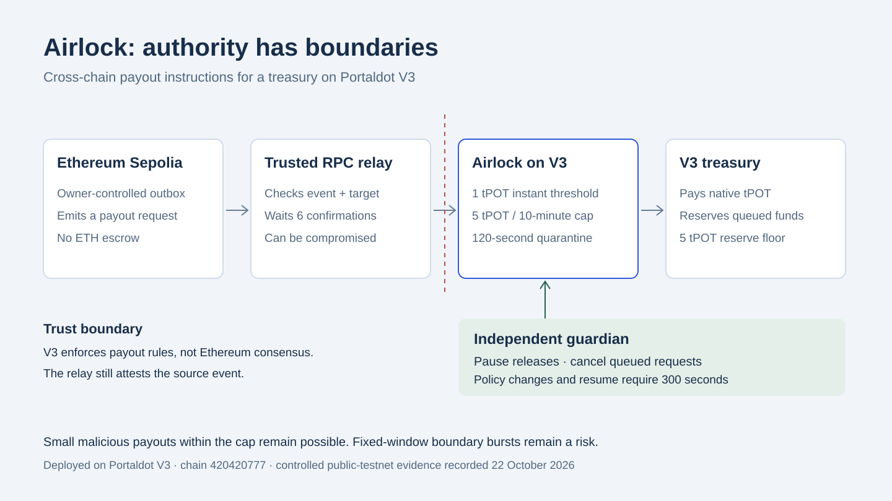

# Airlock

**What if your relay starts sending bad payout instructions?**

Airlock is a payout firewall for teams holding a treasury on **Portaldot V3**. Relay authorization is only the first check: the contract also enforces a spending cap, quarantine, reserve floor, replay protection and independent guardian controls.

**Verified prototype:** Ethereum Sepolia request -> trusted RPC relay -> Portaldot V3. An earlier request paid **0.25 tPOT**. A later controlled **4 tPOT** request entered quarantine, then the guardian paused and cancelled it. During that scenario **0 tPOT was paid**, and the vault remained at **48.75 tPOT**. Releases were left paused; this is a recorded result, not a current-balance promise.

## See the product

Run the console and open **Watch verified walkthrough** on the Control room, or visit `http://127.0.0.1:5173/#demo`. The four-step viewer reads recorded receipts and never signs a transaction. The Control room continues to read live finalized V3 state.

- [Week 2 progress and evidence](docs/check-in/WEEK-2.md)
- [Submission checklist](docs/check-in/SUBMISSION-CHECKLIST.md)
- [Architecture diagram](docs/check-in/architecture.svg)
- [Controlled scenario JSON](artifacts/v3-attack-demo.json)
- Local video: `docs/check-in/airlock-week2.mp4`; a public viewing link is still needed before submission.



A treasury that executes every authorized relay instruction delegates its payout authority to that relay. Airlock constrains that authority on V3. This is an architectural comparison, not a measured claim about losses prevented. Small malicious payouts inside the cap remain possible.

**Trust limits:** the outbox does not escrow ETH, and V3 does not verify Ethereum consensus. The relay trusts configured RPC data. The recorded guardian response occurred after the quarantine delay due to funding recovery; this run proves pause/cancel mechanics, not response within the delay. This is an unaudited testnet prototype.

## Run

Node.js 22+ and npm are required. On Windows the optional native Anvil package runs local regression tests without WSL.

```powershell
npm ci
npm test
npm run dev
```

Open http://127.0.0.1:5173/#overview. The server binds only to loopback. The main interface reads live V3 state; it has no simulated clock, reset or mock balance. The legacy WASM and local EVM modules remain for regression tests, not the main product flow.

For signing, create local `.env` from [.env.example](.env.example): `SEED` must match the pinned sr25519 guardian, and `PRIVATE` must match the configured Ethereum Sepolia outbox owner. The separate V3 EVM relay key is in ignored `deployments/relay-wallet.local.json`. Use disposable test wallets. The server reads keys only for signing and never sends them to the browser, logs or JSON exports. A fresh checkout can inspect the deployment without keys; create a relay setup only for a new deployment, not to replace this contract's immutable relay.

```powershell
npm run build
npm run preview
```

## Deployed addresses and evidence

| Item | Value |
| --- | --- |
| Portaldot V3 chain ID | 420420777 |
| Portaldot V3 contract | `0x3bbb62bf86d40f26a87e70fe56ee073e69198713` |
| Deployment block | 146537 |
| Ethereum Sepolia chain ID | 11155111 |
| Sepolia outbox | `0x92eB46a2a0F8644Ec13fFbD2d7Cb61762c3A95fE` |
| Source request | `0x5eb655a20d68fa0674528cc59beb1c125cfac339de45d4c2c483d6bed37f65a5` |
| V3 payout | `0xd0e326007397ba7fd52c474ed0a18a9dc5adba3f4a667f5c425c8e9605c22605` |

- [Latest end-to-end run](artifacts/v3-console-e2e.json): source receipt, destination receipt, live state and eight integration checks.
- [Initial V3 smoke run](artifacts/v3-live-evidence.json): deployment, payout, quarantine, pause and cancellation. Historical end state was paused with 49 tPOT; the later run resumed and paid another 0.25.
- [Constructor and runtime verification](artifacts/v3-preflight.json), [deployed runtime code](artifacts/v3-deployed-runtime.hex), [verification summary](artifacts/verification.json).
- Network settings: [V3](config/portaldot-v3.json), [Sepolia](config/source-sepolia.json).

Live snapshots and the local operation journal are available in the UI's Evidence page and `/api/live/evidence`. Read-only attack checks have no transaction hash or gas cost. Failed preflight checks are labelled as not broadcast. Pending and uncertain operations are not described as finalized.

## Interface

- **Control room:** finalized reserve, cumulative window budget, queue and bounded payout requests.
- **Quarantine:** on-chain messages, earliest execution time, cap/pause checks and guardian cancellation.
- **Release policy:** guardian schedules limits or resume; anyone may activate after the immutable 300-second delay. The UI signs activation with the local guardian.
- **Evidence:** submission stages, source and destination hashes, current wallet balances and exportable records. Operator funding transfers 1-5 tPOT to the pinned relay; the UI button uses 5.

The emergency pause remains available while a source/relay request is waiting, provided no other guardian transaction is in flight. Source confirmation does not override a later guardian pause. After a timeout or restart an uncertain journal blocks blind retries; reconcile its hashes before attempting a new operation.

## Source and trust model

[AirlockOutbox.sol](contracts/evm/AirlockOutbox.sol) is an owner-controlled Sepolia request emitter. **It does not escrow or bridge ETH.** The local relay checks chain ID, source owner, pinned bytecode hash, receipt target, exactly one matching event, amount, recipient, destination and canonical block after **six confirmations**. Six confirmations are not an Ethereum finalized checkpoint or consensus proof.

Destination nonce is `(11155111 << 32) | sourceNonce`, with sourceNonce limited to 32 bits. The existing V3 source domain remains generic: the immutable V3 contract does not verify or bind the Sepolia source. The configured relay supplies that binding. A compromised relay may fabricate requests and can consume the available allowed budget. Airlock bounds exposure; it cannot eliminate it. Read the [threat model](docs/THREAT-MODEL.md).

The contract caps total releases in fixed windows, including releases executed from quarantine. Queued funds remain reserved. Cancellation consumes the nonce. Guardian pause blocks releases; changing policy or resuming requires the separate delay. Fixed-window boundary bursts and delayed guardian response remain risks.

## Signing and budgets

Native Substrate balances use 14 decimals; Ethereum-compatible V3 calls use 18, with a runtime ratio of 10000. Solidity amounts use EVM units. Constructor initcode includes arguments, while native Revive `data` is empty. V3 supports the solc EVM bytecode; build uses solc 0.8.30, viaIR, optimizer runs 1, Paris. Runtime size is 4865 bytes. The initial storage deposit was about 400.263 tPOT, separately from the 50 tPOT reserve.

V3's Ethereum gas estimates include storage and may require a large upfront balance. Each relay request is limited to 5 tPOT, always paid to the pinned guardian. The relay fee ceiling is 25 tPOT with a 5% gas margin above the gateway estimate. Guardian network fees are capped at 1 tPOT and storage charge at 12 tPOT. Source requests are capped at 0.001 test ETH; source deployment at 0.01 test ETH. Funds and fees are checked before creating the source event, then checked again before relaying it.

Signing requires the exact pinned genesis, chain ID, deployed bytecode and role addresses. The server requires exact loopback Host and Origin, JSON requests and a per-process control token. Request IDs deduplicate double clicks. A write journal is saved before broadcast. Guardian and source seeds stay outside frontend bundles. `/api/action` is retired; `/api/state` and `/api/evidence` return V3 data.

## Development commands

```powershell
npm run build:evm
npm run v3:prepare
npm run v3:deploy:local -- --send-testnet
npm run source:deploy -- --send-testnet
npm run test:live:e2e -- --send-testnet
```

Deployment commands refuse a recorded deployment or uncertain submission journal. The end-to-end script persists its request IDs and can resume the same operation after interruption; it is not a repeated load test and consumes test tokens. Rebuilding Airlock can change its metadata hash; do not substitute another artifact for the reviewed deployed bytecode.

`npm test` runs 46 regression checks, including native local EVM transactions, reentrancy and transfer rollback, compiled WASM invariants, strict V3 bytecode wrapper validation, request limits, idempotency and independent guardian pause. The recorded public-testnet run validates eight integration checks. Full split-attack, reentrancy and policy-edge scenarios remain local coverage, not public-testnet claims.


## Controlled public attack demo

With the local console running, `node scripts/attack-demo.mjs --send-testnet` performs a budget preflight, tops up the relay by at most 5 tPOT while retaining the peak pause storage deposit plus a 1 tPOT margin for the guardian, creates a fixed 4 tPOT Sepolia request, verifies the V3 quarantine, pauses and cancels as guardian. Every signing operation repeats its own fee and identity checks. Source gas is checked separately. The script refuses a second run when its journal exists; inspect saved transactions after interruption rather than replaying them.

The Control room displays the saved evidence from `artifacts/v3-attack-demo.json`. The normal 0.25 tPOT payout is explicitly taken from the earlier cross-testnet run. New-demo metrics distinguish the cancelled 4 tPOT request, actual payout during the scenario, and the vault balance. They do not claim that the entire vault was demonstrably saved. The scenario leaves releases paused. Resume uses the existing 300-second policy delay.

The first run exposed a V3 peak-storage funding requirement: pause preflight rejected before signing with only 1.95 tPOT in the guardian. `scripts/recover-demo.mjs` is a bounded recovery for that existing message: it returns exactly 3 tPOT of relay surplus to the pinned guardian and continues pause/cancel, without creating another source request. It refuses an existing recovery journal. The original failed preflight remains visible in the evidence.
